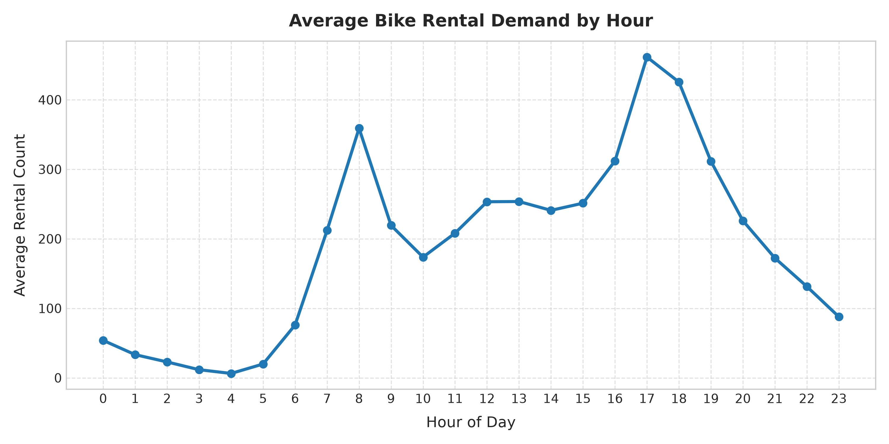
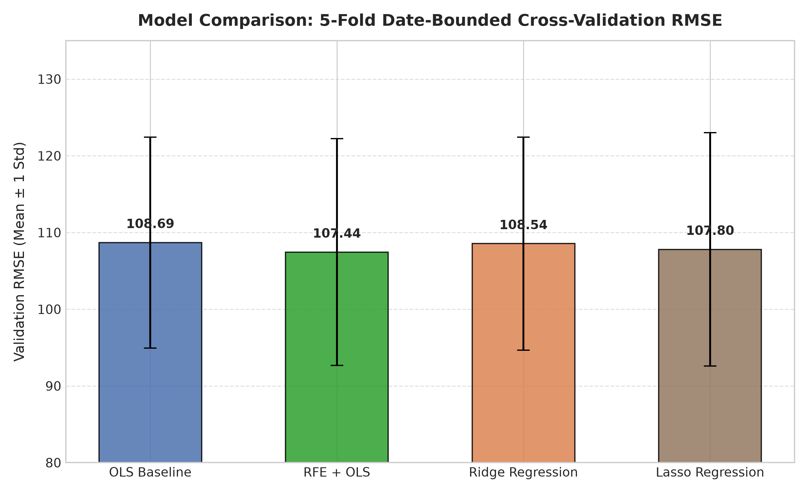
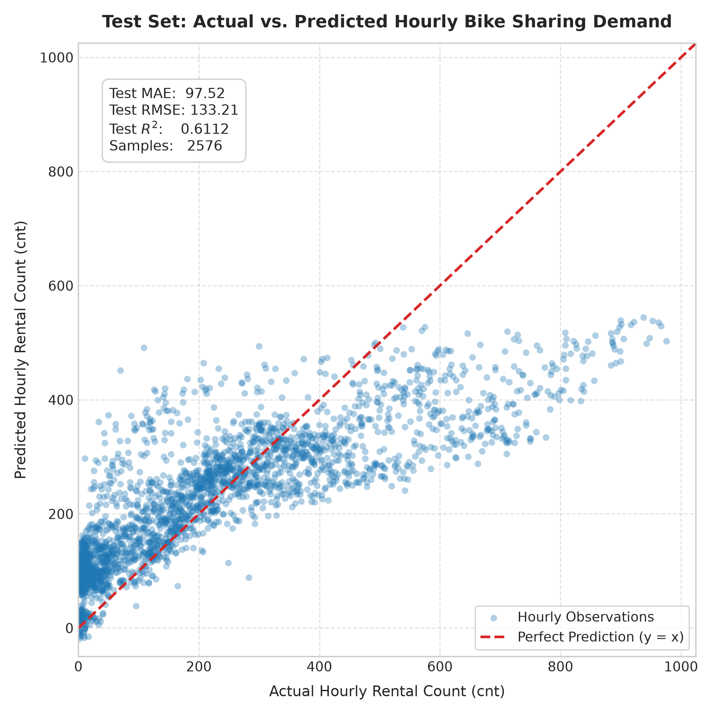
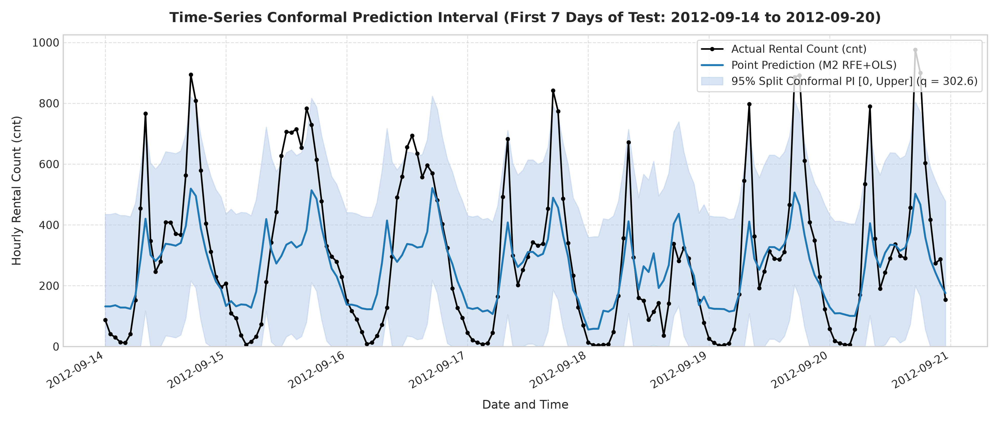

# AIoT HW2 — Predicting Hourly Bike Sharing Demand Using Multiple Linear Regression and Feature Selection

**學生學號 (Student ID):** 7115093001  
**研究題目 (Research Title):** Predicting Hourly Bike Sharing Demand Using Multiple Linear Regression and Feature Selection  
**課程名稱:** 人工智慧與物聯網應用 (AIoT)  
**指導教授:** 課程教學團隊  

---

## 1. 專案總覽 (Project Overview)

本研究旨在探討智慧城市與物聯網（AIoT）架構下之公共自行車即時調度核心問題。透過首都公共自行車系統（Capital Bikeshare）之歷史每小時租借觀測資料，結合日曆時間維度（如時段、星期、工作日、月份、季節）與微氣候感測數據（如氣溫、體感溫度、濕度、風速、天氣狀況），建構高解釋性且穩健之**多元線性迴歸（Multiple Linear Regression, MLR）**與**遞迴特徵消除（Recursive Feature Elimination, RFE）**預測架構。

研究全面依循 **CRISP-DM** 資料探勘生命週期，建立嚴格杜絕未來資訊洩漏之時序切分管線，評比四大多元迴歸模型（OLS 基準、RFE+OLS 特徵選取、Ridge L2 正則化、Lasso L1 正則化），並導入**分拆共形預測（Split Conformal Prediction）**量化預測不確定性，產出具備有限樣本覆蓋保證之 95% 名義預測區間。最終成果透過現代化 **Next.js 16 / TypeScript** 引擎構建互動式學術研究儀表板，提供確定性之預測推論與時序歷程探索。

---

## 2. 核心專案連結 (Project Links)

- **GitHub 專案儲存庫：** [https://github.com/Augustine-723/AIoT_HW2](https://github.com/Augustine-723/AIoT_HW2)
- **互動式研究儀表板 (Vercel Live App)：** [https://a-io-t-hw-2.vercel.app/](https://a-io-t-hw-2.vercel.app/)
- **Kaggle 資料集參考來源：** [https://www.kaggle.com/marklvl/bike-sharing-dataset](https://www.kaggle.com/marklvl/bike-sharing-dataset)
- **UCI 官方原始資料集：** [https://archive.ics.uci.edu/dataset/275/bike+sharing+dataset](https://archive.ics.uci.edu/dataset/275/bike+sharing+dataset)

---

## 3. 資料集說明 (Dataset Description)

本研究使用之資料集為 UCI 機器學習知識庫收錄之經典 **Bike Sharing Dataset (Hourly Version)**。

| 項目 | 規格與說明 |
| :--- | :--- |
| **資料集名稱** | Bike Sharing Dataset — Hourly (`hour.csv`) |
| **總樣本規模** | 17,379 筆逐時觀測記錄 |
| **原始欄位數** | 17 個欄位 |
| **資料涵蓋區間** | 2011 年 1 月 1 日 00:00 至 2012 年 12 月 31 日 23:00（共 731 個日曆天） |
| **預測目標變數** | `cnt`（每小時總租借量，取值範圍 1 ~ 977 輛，平均值 189.46 輛，偏度 1.28 呈右偏分佈） |
| **使用之原始預測變數 (12 項)** | `season`, `yr`, `mnth`, `hr`, `holiday`, `weekday`, `workingday`, `weathersit`, `temp`, `atemp`, `hum`, `windspeed` |
| **嚴格排除欄位 (3 項)** | `instant`（資料庫列序號，無預測意義）、`casual`（未註冊臨時租借量）、`registered`（註冊會員租借量） |
| **實體資料來源** | **UCI Machine Learning Repository 官方原始發布**（SHA-256 雜湊碼：`e03de4ee4ef4dc376ac6e04bf829673c6269e8eba5c60fa121640fa2f829504f`，通過資料完整性校驗） |
| **公開參考來源** | **Kaggle marklvl/bike-sharing-dataset** 為社群公開轉載鏡像（兩者原始觀測筆數與欄位定義一致，本研究清楚區分 UCI 為官方資料來源） |

### 目標洩漏防範機制 (Target Leakage Prevention)
在資料集中，業務恆等式成立：
$$\text{cnt} = \text{casual} + \text{registered}$$
若在特徵工程中納入 `casual` 或 `registered`，模型將學會簡單的加法關係而產生 100% 的**目標洩漏（Target Leakage）**，使事前預測失去實務應用價值。因此，本研究於資料前處理階段**嚴格剔除**此二變數，僅使用預測當下可獲取之日曆與氣象前瞻特徵。

---

## 4. CRISP-DM 研究流程 (CRISP-DM Workflow)

本專案嚴格遵循跨產業資料探勘標準程序（CRISP-DM）之六大階段：

```text
[1. Business Understanding] ──> [2. Data Understanding] ──> [3. Data Preparation]
                                                                     │
[6. Deployment]            <── [5. Evaluation]        <── [4. Modeling]
```

1. **Business Understanding (商業理解)：**
   - 聚焦公共自行車系統因潮汐人流導致的站點車輛枯竭或滿溢問題。
   - 將物聯網感測預測任務定義為多變數數值迴歸，確立以 MAE、RMSE 為主之精度評估準則，並透過預測區間提供維運調度之風險緩衝估算。

2. **Data Understanding (資料理解)：**
   - 執行多維度探索性資料分析（EDA），識別出尖峰通勤時段（08:00 及 17:00–18:00）的雙峰用車型態。
   - 審計 2011–2012 年曆法跨度中 165 個缺漏小時（Gap Hours，多發生於深夜維護或極端氣候），確認無重複記錄，且資料時間序列嚴格單調遞增。

3. **Data Preparation (資料準備)：**
   - 實施防範時序未來資訊洩漏之時間軸切分：
     - **訓練集 (Training Set, 70%):** 2011-01-01 至 2012-05-26 (12,163 筆)
     - **校準集 (Calibration Set, 15%):** 2012-05-27 至 2012-09-13 (2,640 筆，專供共形預測校準)
     - **測試集 (Test Set, 15%):** 2012-09-14 至 2012-12-31 (2,576 筆，密封隔離至 Phase 3 評估)
   - 類別變數採用 One-Hot 編碼，數值變數透過 StandardScaler 標準化，共展開為 53 個候選特徵維度。

4. **Modeling (模型建構)：**
   - 建置四組對照模型：M1 (OLS Baseline)、M2 (RFE + OLS)、M3 (Ridge L2)、M4 (Lasso L1)。
   - 在訓練集上實施嚴格依據**日期分組的 5 折擴展視窗交叉驗證（Date-bounded 5-Fold Expanding-window Cross-Validation）**，模擬真實世界時間遞移之滾動訓練。

5. **Evaluation (模型評估)：**
   - 依據 CV RMSE 指標選定最佳模型 M2。
   - 解封測試集執行**嚴格一次性（Exactly-Once）**評估，絕不事後逆向調參。
   - 利用獨立校準集計算絕對殘差分位數，構建具備非負截斷之 95% Split Conformal 預測區間，並對尖峰時段覆蓋率進行診斷分析。

6. **Deployment (系統部署)：**
   - 將最佳 M2 模型參數、截距與共形分位數凍結為 JSON 規範檔。
   - 於 Next.js 16 (App Router) 與 TypeScript 環境下實作確定性雙精度推論引擎，無縫發布於 Vercel 雲端邊緣網路。

---

## 5. 模型比較與特徵選取 (Model Comparison)

本研究實作四種多元線性迴歸模型，在訓練集上採用日期分組之 5 折擴展視窗交叉驗證（無偏樣本標準差 $ddof=1$）進行公平客觀評比：

| 模型編號 | 模型架構 (Model Architecture) | 超參數配置 (Hyperparameters) | 選定特徵數 (Features) | 5-Fold CV RMSE (輛) | 5-Fold CV MAE (輛) | 5-Fold CV $R^2$ |
| :---: | :--- | :--- | :---: | :---: | :---: | :---: |
| **M1** | Ordinary Least Squares (OLS 基準) | 無 (使用全部編碼特徵) | 53 | 108.6860 | 81.2065 | 0.4624 |
| **M2** | **RFE + OLS (特徵消除迴歸)** | **$k = 30$** | **30** | **107.4394** | **79.9859** | **0.4767** |
| **M3** | Ridge Regression (嶺迴歸) | $\alpha = 1.0$ | 53 | 108.5437 | 81.0700 | 0.4645 |
| **M4** | Lasso Regression (套索迴歸) | $\alpha = 0.1$ | 47 | 107.7984 | 79.7394 | 0.4757 |

### 最佳模型選定依據：
- **模型 M2 (RFE + OLS)** 在 5 折擴展交叉驗證中取得最低之平均驗證誤差（**CV RMSE 107.4394 輛**）與最高之判定係數（**CV $R^2$ 0.4767**）。
- 透過遞迴特徵消除（RFE），模型成功從 53 個候選特徵中剔除 23 個次要或共線性變數，精簡收斂至 **30 個關鍵特徵**（包含早晚通勤尖峰時段、工作日與週末型態、季節及核心溫濕度特徵），達成卓越之模型精簡度（Sparsity）與泛化能力。

---

## 6. 最終測試集評估與共形預測 (Final Evaluation)

定案之最佳模型 M2 在完全隔離密封之未觀測測試集（Test Set）上進行**嚴格一次性最終評估**，實驗數據記錄如下：

### 6.1 測試集核心表現指標 (Final Test Set Metrics)

| 評估指標名稱 | 數值 | 說明與基準對照 |
| :--- | :---: | :--- |
| **測試集樣本數 (Test Samples)** | **2,576 筆** | 涵蓋 2012-09-14 至 2012-12-31（109 個完整日曆天） |
| **平均絕對誤差 (MAE)** | **97.5211 輛** | 平均預測偏差控制在百輛以內 |
| **均方誤差 (MSE)** | **17744.5877 輛$^2$** | 懲罰大幅度預測偏差之整體指標 |
| **均方根誤差 (RMSE)** | **133.2088 輛** | 對照常數基準 DummyRegressor (226.1197 輛)，誤差大幅縮減 **41.09%** |
| **判定係數 ($R^2$)** | **0.6112** | 解釋測試集超過 61% 之用車需求變異 (Dummy 為 -0.1198) |

### 6.2 分拆共形預測區間 (Split Conformal Prediction Intervals)

為解決線性迴歸高斯殘差假設在計數資料中極易失效的問題，本研究透過獨立校準集（2,640 筆）校準得出絕對殘差分位數 $q = 302.6015$，並施加非負物理下界截斷 $\max(0, \hat{y} - q)$：

| 共形預測評估項目 | 實驗記錄數值 | 學術意涵 |
| :--- | :---: | :--- |
| **名義預測區間水準 (Nominal Level)** | **95.00%** | 理論設定之信賴覆蓋期望 |
| **實證經驗覆蓋率 (Empirical Coverage)** | **94.84%** | 測試集 2,576 筆中共有 2,443 筆真實需求落於區間內，高度契合 95% 目標 |
| **非負截斷平均區間寬度 (Avg Clipped Width)**| **513.1870 輛** | 經截斷排除負數無效空間後之平均不確定性頻寬 |
| **校準分位數 ($q$)** | **302.6015 輛** | 絕對殘差之第 95 百分位數臨界邊際 |

### 6.3 尖峰時段不確定性診斷 (Commuting Peak Coverage Analysis)
深入檢視各小時實證覆蓋率發現：
- **通勤尖峰時段覆蓋率顯著較低：** **08:00 為 64.49%**、**17:00 為 75.00%**、**18:00 為 80.56%**。
- **離峰時段表現：** 深夜（00:00–05:00）與白晝平原時段之覆蓋率均達 **98%–100%**。
- **學術意涵：** 邊際共形預測（Marginal Conformal Prediction）雖保證全域平均覆蓋率達標（94.84%），但因尖峰時段用車波動極具異質變異性（Heteroscedasticity），顯示尖峰時段之條件預測不確定性極具研究價值，未來應探索自適應局部共形預測。

---

## 7. 視覺化分析圖表 (Visualizations)

本專案於 `7115093001_hw2/figures/` 目錄中產出 12 張學術級視覺化圖表，以下嵌入本研究最具代表性之核心圖表（相對路徑引用）：

### 7.1 EDA 24 小時需求趨勢曲線
工作日顯現顯著之通勤雙峰（08:00 與 17:00–18:00），非工作日則呈現午後單一寬闊高原（12:00–16:00）：
<div align="center">
  
  <p><em>圖 1：探索性資料分析 — 24 小時租借需求趨勢圖（工作日 vs 非工作日型態對比）</em></p>
</div>

### 7.2 四大候選模型 5-Fold CV 綜合評比
以無偏樣本標準差（$ddof=1$）呈現 M1 至 M4 在五折擴展視窗下之驗證 RMSE 表現，M2 (RFE+OLS) 展現最佳綜合穩定度：
<div align="center">
  
  <p><em>圖 2：候選模型評比 — 5-Fold Expanding Window 交叉驗證 RMSE 誤差條柱狀圖</em></p>
</div>

### 7.3 測試集真實值 vs 預測值分佈 (Actual vs. Predicted)
測試集 2,576 筆觀測值之預測值與真實值散佈圖，緊密圍繞 $y = x$ 理想預測基準線：
<div align="center">
  
  <p><em>圖 3：泛化性能驗證 — 測試集真實租借量 vs M2 預測租借量散佈圖（含理想對角線）</em></p>
</div>

### 7.4 測試集 95% Split Conformal 預測區間時序追蹤
測試集前 7 天（連續 168 小時）代表性時間序列，展示非負截斷共形預測區間對實際租借動態的精確包絡：
<div align="center">
  
  <p><em>圖 4：不確定性量化 — 測試集前 7 天 95% 共形預測區間與實際租借量時間序列圖</em></p>
</div>

---

## 8. 互動式研究儀表板 (Interactive Dashboard)

為實踐 AIoT 成果之互動視覺化，本專案打造了功能完備之現代化 Web 儀表板，線上展示網址為：  
👉 **[https://a-io-t-hw-2.vercel.app/](https://a-io-t-hw-2.vercel.app/)**

### 8.1 儀表板核心功能模組
1. **Research Overview (研究總覽):** 綜覽核心研究指標（Test MAE 97.52, RMSE 133.21, $R^2$ 0.6112, 覆蓋率 94.84%）、學生資訊與 CRISP-DM 架構。
2. **Dataset & EDA (資料集探索):** 互動式檢視日夜用車週期、氣候相關矩陣、165 個缺漏時段審計以及 Target Leakage 排除宣告。
3. **Model Comparison (模型評比與消融):** 完整收錄 M1–M4 之 5 折 Expanding Window CV 統計、RFE 淘汰歷程與 12 大原生特徵群組消融 ΔRMSE 影響圖。
4. **Evaluation (測試集評估與歷程探索):** 散佈圖診斷、全量 2,576 筆測試預測之自訂日期歷程探索器（支援桑迪颶風、感恩節週、聖誕假期等情境切片）、動態 MAE/RMSE/覆蓋率重算與時段覆蓋長條圖。
5. **Interactive Prediction (即時預測推論):** 支援 12 項特徵輸入之集中驗證、上下界自動防呆、曆法矛盾邏輯提示（如週末標記為工作日）、5 大典型情境快速載入，並即時運算點預測、95% 預測區間與個別特徵貢獻分項。
6. **Methodology (研究方法論):** CRISP-DM 端到端管線流程圖、分拆共形預測數學公式推導、時序可交換性假設討論與學術參考文獻。

### 8.2 技術架構與服務性質聲明
- **技術堆疊：** Next.js 16 (App Router)、TypeScript、Tailwind CSS、Turbopack。
- **推論架構：** 採行確定性 TypeScript 引擎，直接讀取權威規格檔 `website/data/m2_model_spec.json` 執行已擬合之 M2 線性方程式（截距 `-76.1581`，30 項特徵係數，校準分位數 $q=302.6015$），雙向浮點精度對齊誤差小於 $10^{-13}$。
- **重要聲明：** 本網站定位為**學術研究與實驗成果展示平台**，旨在直觀呈現迴歸模型之推論行為，**並非接入即時感測串流或具備即時負載容錯之商業營運物聯網服務**。

---

## 9. 本地執行與重現指南 (How to Run)

本儲存庫具備高度獨立性，已內建所有實驗資料與重現腳本。請依照以下步驟於本地端重現研究成果：

### 9.1 環境準備與 Clone 專案
```bash
# 複製本儲存庫
git clone https://github.com/Augustine-723/AIoT_HW2.git
cd AIoT_HW2
```

### 9.2 Python 研究環境配置
```bash
# 進入核心研究工作區
cd 7115093001_hw2

# 建議建立並啟用 Python 3.10+ 虛擬環境 (Windows PowerShell)
python -m venv .venv
.venv\Scripts\Activate.ps1

# 安裝相依套件 (包含 scikit-learn, pandas, statsmodels, jupyter 等)
pip install -r requirements.txt
```

### 9.3 執行研究實驗與 Notebook
本專案提供多種執行方式：

1. **直接開啟主 Jupyter Notebook 查看完整成果：**
   ```bash
   jupyter notebook 7115093001_hw2.ipynb
   ```
   *註：Notebook 已內建所有階段之輸出數據與 12 張圖表，亦可於虛擬環境下一鍵「Run All」自資料集 `data/hour.csv` 重新計算產出。*

2. **透過模組化自動腳本重新執行全流程：**
   ```bash
   # Phase 1: 資料完整性審計、EDA、時序切分與 OLS 基準
   python run_phase1.py

   # Phase 2: RFE 特徵選取、Ridge/Lasso 正則化與群組特徵消融
   python run_phase2.py

   # Phase 3: Split Conformal 預測區間校準與測試集最終評估
   python run_phase3.py

   # 自動編譯產出完整可執行的 7115093001_hw2.ipynb
   python build_notebook.py

   # 執行 Python 與 TypeScript 雙精度數值對齊測試
   python test_parity_reproducible.py

   # 同步實驗資料與圖表至網站目錄
   python export_website_data.py
   ```

### 9.4 本地啟動前端展示網站 (選用)
```bash
# 返回專案根目錄後進入 website
cd ../website

# 安裝 Node 相依套件
npm install

# 執行 TypeScript 數值推論引擎一致性測試
npm run test:parity

# 啟動本地開發伺服器 (預設運行於 http://localhost:3000)
npm run dev
```

---

## 10. 課程正式繳交內容 (Homework Submission)

依據 AIoT HW2 課程規定，正式繳交成果如下：

1. **主程式檔案：** [`7115093001_hw2/7115093001_hw2.ipynb`](7115093001_hw2/7115093001_hw2.ipynb)
   - 包含 Phase 1 至 Phase 3 的端到端完整研究程式碼與執行結果儲存格。
2. **整合型 PDF 報告：** `7115093001_hw2.pdf`
   - **整合報告完整章節架構：**
     1. CRISP-DM 六大階段之深入分析與業務決策脈絡
     2. 多元線性迴歸、RFE 特徵消除、Ridge/Lasso 正則化與共形預測區間之完整評估圖表
     3. 運用 Google NotebookLM 輔助生成之論文文獻脈絡與專案研究摘要
     4. 網路主流方法與非線性機器學習模型（Random Forest, Gradient Boosting, LightGBM, ANN）之文獻綜述比較
     5. 大型語言模型（GPT / LLM）完整協同對話紀錄附錄

### 助教執行環境特別提醒：
- 若助教需要從頭執行（Run All）Jupyter Notebook，所需之官方原始逐時觀測資料集已完備存放於 [`7115093001_hw2/data/hour.csv`](7115093001_hw2/data/hour.csv)。
- Notebook 具備自給自足之檔案路徑定義，僅需於安裝 `requirements.txt` 後之 Python 環境直接執行即可產出全量成果。

### Kaggle 競賽名次聲明：
- **Kaggle 排行榜名次：`N/A`**  
  *說明：本研究採用 Kaggle 公開收錄之 Bike Sharing Dataset 鏡像作為學術研究資料集，本專案主要探討特徵選擇、線性迴歸正則化與共形預測區間之統計特性，並未報名參加 Kaggle 即時排行榜競賽。*

---

## 11. 研究限制與未來展望 (Research Limitations)

1. **歷史資料時空範圍局限：**
   - 資料集觀測時間為 2011 年至 2012 年之美國華盛頓特區，無法捕捉近年疫情後工作型態轉變、共享電動滑板車或電動輔助自行車普及等新型態微移動生態。
2. **非線性模型本地實驗比較未納入：**
   - 本研究聚焦於線性迴歸家族之統計可解釋性與特徵選取機制。雖然於整合書面報告中針對隨機森林（Random Forest）、梯度提升樹（Gradient Boosting / XGBoost / LightGBM）及人工神經網路（ANN）進行了深入的學術文獻綜述，但在本地專案代碼中尚未實作上述非線性模型的實證比對。
3. **時間相依性對共形預測理論假設之影響：**
   - 標準 Split Conformal Prediction 之無分佈邊際覆蓋率保證建立於校準樣本與測試樣本具備「可交換性」（Exchangeability / i.i.d.）之數學假設。
   - 由於逐時租借量具備強烈時間自相關性、日夜通勤週期與跨年度增長（概念漂移），可交換性在嚴格時序資料下未能完全成立。因此 95% 為名義設定水準，儘管測試集實證覆蓋率達 94.84%，在連續極端氣候或劇烈突發事件下仍可能出現局部失準。
4. **通勤尖峰時段之條件預測不確定性：**
   - 尖峰時段（08:00、17:00 與 18:00）的經驗覆蓋率顯著降至 64% 至 80% 之間。這表明線性迴歸在面對極端需求衝擊與尖峰高波動時存在預測瓶頸，未來研究可結合共形化分位數迴歸（Conformalized Quantile Regression, CQR）或時間序列自適應共形預測算法進一步優化。

---

## 12. 專案隔離宣告 (Project Isolation Statement)

- 本儲存庫為 `Augustine-723/AIoT_HW2`，所有研究代碼、文件與展示網站均獨立構建與提交。
- 本專案完全獨立運作，**嚴格未修改、亦未相依於先前之 `Augustine-723/50-Starup` 儲存庫或其既有 Vercel 部署**。
